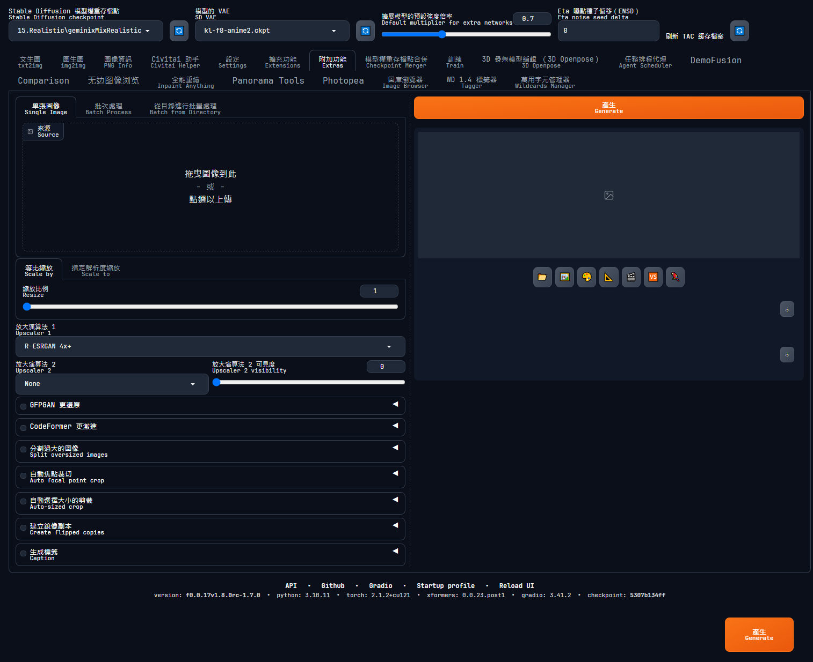

[中文文档](README_ZH.md) / [日本語](README_JA.md)

<p align="center"></p>

# sd-webui-bilingual-localization
[Stable Diffusion web UI](https://github.com/AUTOMATIC1111/stable-diffusion-webui) bilingual localization extensions.

> Refactored from [journey-ad](https://github.com/journey-ad/sd-webui-bilingual-localization), rewritten in TypeScript for improved bug fixes and performance enhancements.



## Features
- Bilingual translation, no need to worry about how to find the original button.
- Compatible with language pack extensions, no need to re-import.
- Support dynamic translation of title hints.
- Additional support Scoped and RegExp pattern, more flexible translation.

## Installation

Choose one of the following methods, Need to use webui with extension support <sup>(Versions after 2023)</sup>

#### Method 1

Use the `Install from URL` provided by webui to install

Click in order <kbd>Extensions</kbd> - <kbd>Install from URL</kbd>

Then fill in the first text box with `https://github.com/bluelovers/sd-webui-bilingual-localization.git`, click the <kbd>Install</kbd> button.


After that, switch to the <kbd>Installed</kbd> panel and click the <kbd>Apply and restart UI</kbd> button.


#### Method 2

Clone to your extension directory manually.

```bash
git clone https://github.com/bluelovers/sd-webui-bilingual-localization.git extensions/sd-webui-bilingual-localization
```

## Usage

> **⚠️Important⚠️**   
> Make sure <kbd>Settings</kbd> - <kbd>User interface</kbd> - <kbd>Localization</kbd> is set to `None`

In <kbd>Settings</kbd> - <kbd>Bilingual Localization</kbd> panel, select the localization file you want to enable and click on the <kbd>Apply settings</kbd> and <kbd>Reload UI</kbd> buttons in turn.


> Optional: set `bilingual_localization_order` to `Original First` to display the original text before the translation (swaps their positions).

> Note: if a translation already starts with the original text, only the translation is shown — no bilingual wrapper is generated.

## Troubleshooting

> **⚠️ If the plugin is not working properly**   
> Open sd-webui's `config.json` and delete the `bilingual_localization_dirs` entry, or manually set it to the path of your localization files:
>
> ```json
> "bilingual_localization_dirs": "{\"zh_Hans\": \"extensions/stable-diffusion-webui-localization-zh_Hant/localizations/zh_Hans.json\", \"zh_Hant\": \"extensions/stable-diffusion-webui-localization-zh_Hant/localizations/zh_Hant.json\"}"
> ```

## Scoped

Localization supports scoped to prevent global polluting. The syntax rules are as follows:
- `##<SCOPE ID>##<TEXT>` Scoped text will only take effect when the ancestor element ID matches the specified scope.
- `##@<SELECTOR>##<TEXT>` Scoped text will only take effect when the ancestor element matches the specified CSS selector.
- If the element lies outside every scope, translation falls back to the global entry.
- Always prefix non-ID selectors with `@`: `##.class##` would be rewritten to the invalid selector `#.class`.

```json
{
  ...
  "##tab_ti##Normal": "正态", // only the text `Normal` under the element with id="tab_ti" will be translated to `正态`.
  "##tab_threedopenpose##Normal": "法线图", // only the text `Normal` under the element with id="tab_threedopenpose" will be translated to `法线图`.
  "##@.extra-networks .tab-nav button##Lora": "Lora模型", // only the text `Lora` under the element with class=".extra-networks .tab-nav button" will be translated to `Lora模型`.
  ...
}
```

## RegExp pattern

Localization supports RegExp patterns. The key must be written as `@@</pattern/flags>` — the pattern wrapped in `/.../`, flags optional; a key without `/.../` is escaped and matched literally. Capturing groups are referenced as `$n`, doc: [String.prototype.replace()](https://developer.mozilla.org/docs/Web/JavaScript/Reference/Global_Objects/String/replace)

Patterns are checked in the order they appear in the file and the first match wins — anchor with `^...$` so an earlier generic pattern cannot steal the match, and avoid the `g` flag.

```json
{
  ...
  "@@/^(\\d+) images in this directory, divided into (\\d+) pages$/": "目录中有$1张图片，共$2页",
  "@@/^Favorites path from settings: (.*)$/": "设置的收藏夹目录：$1",
  ...
}
```

Full syntax reference: [SYNTAX.md](SYNTAX.md).

## Ignoring elements

Add these classes to an element to keep it from being translated:

- `.bilingual__trans_ignore` — ignore the element itself.
- `.bilingual__trans_ignore_deep` — ignore the element and all of its descendants.

## How to get localization file

Localization files are no longer provided with the plugin, please install a third-party language extensions and set-up as described in the [Usage](#usage) section of this article.

Recommended language pack: https://github.com/bluelovers/stable-diffusion-webui-localization-zh_Hant
Japanese language pack: https://github.com/L4Ph/stable-diffusion-webui-localization-ja_JP
