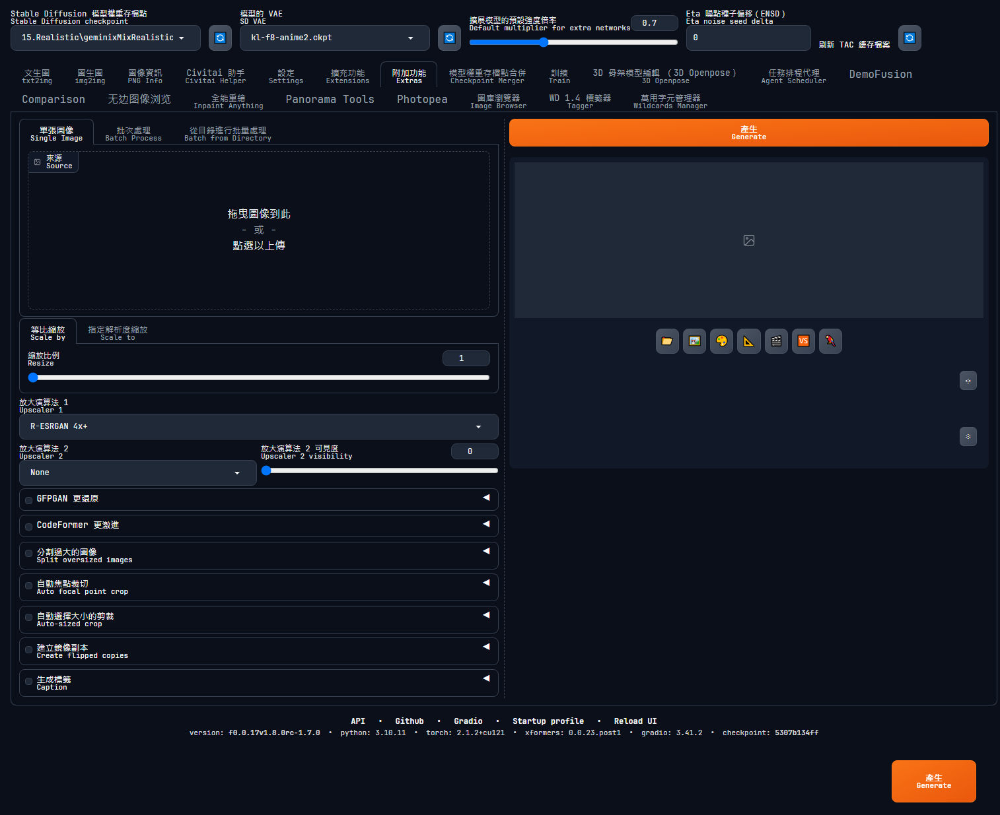

[English](README.md) / [中文](README_ZH.md)

<p align="center"></p>

# sd-webui-bilingual-localization
[Stable Diffusion web UI](https://github.com/AUTOMATIC1111/stable-diffusion-webui)のバイリンガル対応拡張機能

> [journey-ad](https://github.com/journey-ad/sd-webui-bilingual-localization) のコードをベースに、TypeScript で書き換えて、バグ修正とパフォーマンスを強化しました。



## 特徴
- バイリンガル対応により、元のボタンを探す必要がありません。
- 日本語化拡張機能と互換性があり、ファイルを取り込み直す必要はありません。
- ツールチップの動的翻訳をサポートします。
- スコープと正規表現パターンによる柔軟な翻訳が可能です。

## インストール

以下の方法から選択します。
拡張機能に対応したWebUI<sup>(2023年以降のバージョン)</sup>が必要です。

#### 方法1

WebUIの`Install from URL`でインストールを行います。

<kbd>Extensions</kbd> - <kbd>Install from URL</kbd>を順にクリックします。

1個目のテキストボックスに`https://github.com/bluelovers/sd-webui-bilingual-localization.git`を入力し、<kbd>Install</kbd>ボタンをクリックします。


その後、<kbd>Installed</kbd>パネルに切り替え、<kbd>Apply and restart UI</kbd>ボタンをクリックします。


#### 方法2

拡張機能のディレクトリに手動でcloneします。

```bash
git clone https://github.com/bluelovers/sd-webui-bilingual-localization.git extensions/sd-webui-bilingual-localization
```

## 使用方法

> **⚠️重要⚠️**  
> <kbd>Settings</kbd> - <kbd>User interface</kbd> - <kbd>Localization</kbd>が`None`に設定されていることを確認してください。

<kbd>Settings</kbd> - <kbd>Bilingual Localization</kbd>パネルで、有効にしたい言語ファイル名を選択し、<kbd>Apply settings</kbd>ボタンと<kbd>Reload UI</kbd>ボタンを順にクリックします。


> 任意：`bilingual_localization_order` を `Original First` に設定すると、原文が訳文より先に表示されます（位置が入替わります）。

> 注意：訳文が原文で始まる場合、訳文のみが表示され、バイリンガル枠は生成されません。

## トラブルシューティング

> **⚠️ プラグインが正常に動作しない場合**   
> sd-webui の `config.json` を開き、`bilingual_localization_dirs` エントリを削除するか、ローカリゼーションファイルのパスを手動で設定してください：
>
> ```json
> "bilingual_localization_dirs": "{\"zh_Hans\": \"extensions/stable-diffusion-webui-localization-zh_Hant/localizations/zh_Hans.json\", \"zh_Hant\": \"extensions/stable-diffusion-webui-localization-zh_Hant/localizations/zh_Hant.json\"}"
> ```

## スコープ

ローカリゼーションは、グローバルな影響を防ぐためにスコープを限定したサポートを提供します。構文規則は以下の通りです：
- `##<SCOPE ID>##<TEXT>` スコープが指定された要素の祖先のIDと一致する場合にのみ、スコープ付きのテキストが適用されます。
- `##@<SELECTOR>##<TEXT>` スコープが指定されたCSSセレクタと一致する場合にのみ、スコープ付きのテキストが適用されます。
- 要素がどのスコープにも属さない場合、グローバルな翻訳にフォールバックします。
- ID 以外のセレクタには必ず `@` を付けてください。`##.class##` は不正なセレクタ `#.class` に変換されます。

```json
  ...
  "##tab_ti##Normal": "正常", // id="tab_ti"の要素の下にある`Normal`のみが`正常`に変換されます
  "##tab_threedopenpose##Normal": "法線マップ", // id="tab_threedopenpose"の要素の下にある`Normal`のみが `法線マップ`に変換されます
  "##@.extra-networks .tab-nav button##Lora": "Loraモデル", // class=".extra-networks .tab-nav button"の要素の下にある`Lora`のみが`Loraモデル`に変換されます
  ...
```

## 正規表現パターン

正規表現を使った日本語化が可能です。key は `@@</pattern/flags>` 形式（`/.../` で囲み、flags は省略可）で記述します。`/.../` でない key はエスケープされ、文字列そのものと一致します。キャプチャグループは `$n` で参照します。ドキュメント：[String.prototype.replace()](https://developer.mozilla.org/docs/Web/JavaScript/Reference/Global_Objects/String/replace)。

正規表現はファイル内の key 順に照合され、最初に一致したものが使用されます —— `^...$` でアンカーし、先に書かれた汎用ルールに奪われないようにしてください。`g` フラグは避けてください。

```json
{
  ...
  "@@/^(\\d+) images in this directory, divided into (\\d+) pages$/": "このディレクトリには$1枚の画像、$2ページ",
  "@@/^Favorites path from settings: (.*)$/": "お気に入りのディレクトリパス：$1",
  ...
}
```

完全な構文リファレンス：[SYNTAX.md](SYNTAX.md)。

## 要素の無視

要素に以下の class を追加すると、翻訳されなくなります：

- `.bilingual__trans_ignore` —— 要素自身のみを無視
- `.bilingual__trans_ignore_deep` —— 要素とそのすべての子孫を無視

## 日本語化ファイルの取得

内蔵の日本語化ファイルは提供されなくなりました。サードパーティーの日本語化拡張機能をインストールし、当ページの[使用方法](#使用方法)に記載されている方法でセットアップしてください。

*プレビュー画像の言語パックはこちら：https://gist.github.com/journey-ad/d98ed173321658be6e51f752d6e6163c*
