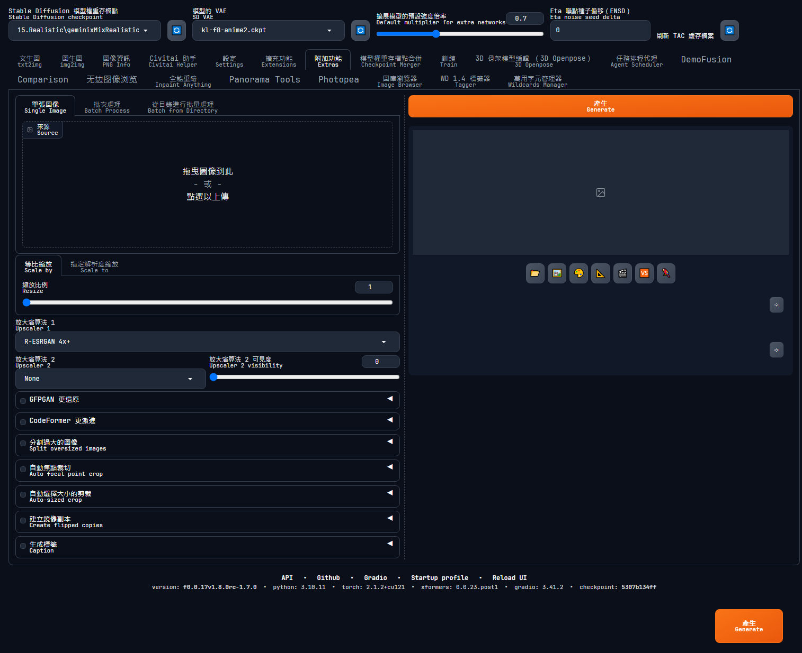

[English](README.md) / [日本語](README_JA.md)

<p align="center"></p>

# sd-webui-bilingual-localization
[Stable Diffusion web UI](https://github.com/AUTOMATIC1111/stable-diffusion-webui) 双语对照翻译插件

> 重構自 [journey-ad 的 Bilingual Localization](https://github.com/journey-ad/sd-webui-bilingual-localization)，以 TypeScript 重寫，修正錯誤並提升效能。



## 功能
- 全新实现的双语对照翻译功能，不必再担心切换翻译后找不到原始功能
- 兼容原生语言包扩展，无需重新导入多语言语料
- 支持动态title提示的翻译
- 额外支持作用域和正则表达式替换，翻译更加灵活

## 安装

以下方式选择其一，需要使用支持扩展功能的 webui <sup>(2023年之后的版本)</sup>

#### 方式1

使用 webui 提供的`Install from URL`功能安装

按下图所示，依次点击<kbd>Extensions</kbd> - <kbd>Install from URL</kbd>

然后在第一个文本框内填入`https://github.com/bluelovers/sd-webui-bilingual-localization.git`，点击<kbd>Install</kbd>按钮


之后切换到<kbd>Installed</kbd>面板，点击<kbd>Apply and restart UI</kbd>按钮


#### 方式2

手动克隆到你的扩展目录里

```bash
git clone https://github.com/bluelovers/sd-webui-bilingual-localization.git extensions/sd-webui-bilingual-localization
```

## 使用

> **⚠️重要⚠️**   
> 确保<kbd>Settings</kbd> - <kbd>User interface</kbd> - <kbd>Localization</kbd> 已设置为了 `None`

在<kbd>Settings</kbd> - <kbd>Bilingual Localization</kbd>中选择要启用的本地化文件，依次点击<kbd>Apply settings</kbd>和<kbd>Reload UI</kbd>按钮


> 可选：将 `bilingual_localization_order` 设为 `Original First`，可让原文显示在译文之前（两者位置互换）。

> 注意：若译文以原文开头，则只显示译文，不再生成双语对照框。

## 故障排除

> **⚠️ 如果插件無法正常運作**   
> 開啟 sd-webui 的 `config.json`，刪除 `bilingual_localization_dirs` 設定，或手動設定為你的本地化檔案路徑：
>
> ```json
> "bilingual_localization_dirs": "{\"zh_Hans\": \"extensions/stable-diffusion-webui-localization-zh_Hant/localizations/zh_Hans.json\", \"zh_Hant\": \"extensions/stable-diffusion-webui-localization-zh_Hant/localizations/zh_Hant.json\"}"
> ```

## 作用域支持

本地化语料支持限定作用域，防止影响全局翻译，语法规则：
- `##<SCOPE ID>##<TEXT>` 仅当节点祖先元素ID匹配指定的作用域时才会生效
- `##@<SELECTOR>##<TEXT>` 仅当节点祖先元素匹配指定的CSS选择器时才会生效
- 节点不在任何作用域内时，回落到全局翻译条目
- 非 ID 选择器务必加 `@`：`##.class##` 会被补成非法选择器 `#.class`

```json
{
  ...
  "##tab_ti##Normal": "正态", // 仅id="tab_ti"元素下的`Normal`会被翻译为`正态`
  "##tab_threedopenpose##Normal": "法线图", // 仅id="tab_threedopenpose"元素下的`Normal`会被翻译为`法线图`
  "##@.extra-networks .tab-nav button##Lora": "Lora模型", // 仅class=".extra-networks .tab-nav button"元素下的`Lora`会被翻译为`Lora模型`
  ...
}
```

## 正则表达式支持

本地化语料支持正则表达式替换。key 需写成 `@@</pattern/flags>` 形式（`/.../` 包裹，flags 可省略）；不带 `/.../` 的会被转义为逐字匹配。括号匹配变量 `$n`，参考 [String.prototype.replace()](https://developer.mozilla.org/docs/Web/JavaScript/Reference/Global_Objects/String/replace)

正则按文件内 key 顺序比对，先命中者生效 —— 建议加 `^...$` 锚定，避免被较早的通用规则抢先；避免使用 `g` 旗标。

```json
{
  ...
  "@@/^(\\d+) images in this directory, divided into (\\d+) pages$/": "目录中有$1张图片，共$2页",
  "@@/^Favorites path from settings: (.*)$/": "设置的收藏夹目录：$1",
  ...
}
```

完整语法请见 [SYNTAX.md](SYNTAX.md)。

## 忽略元素

为元素添加以下 class 可使其不被翻译：

- `.bilingual__trans_ignore` —— 仅忽略该元素本身
- `.bilingual__trans_ignore_deep` —— 忽略该元素及其所有子元素

## 获取本地化文件

本地化文件不再随插件提供，请安装第三方语言包并按照本文[使用](#使用)部分的方式设置使用

推荐语言包：https://github.com/bluelovers/stable-diffusion-webui-localization-zh_Hant
日文语言包：https://github.com/L4Ph/stable-diffusion-webui-localization-ja_JP
